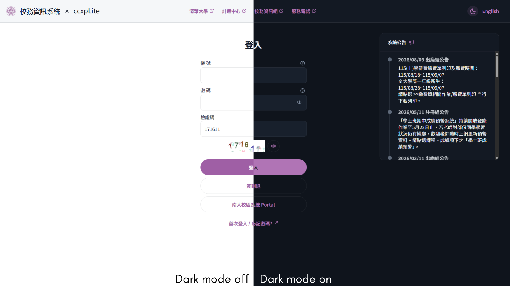
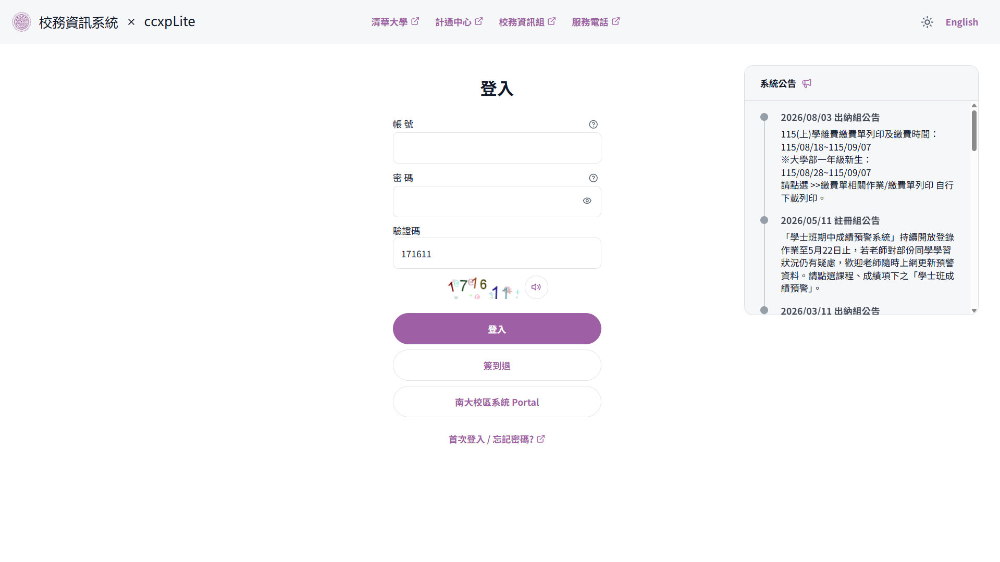
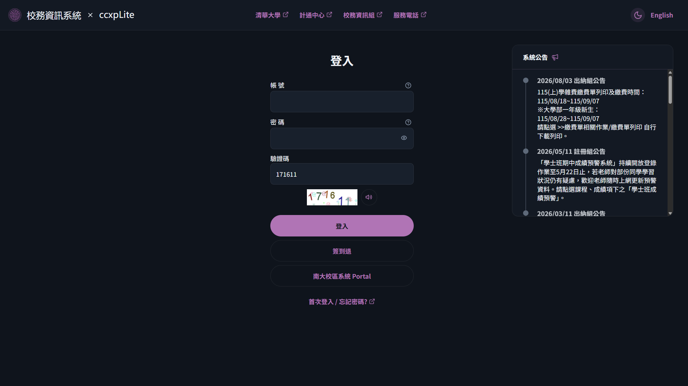
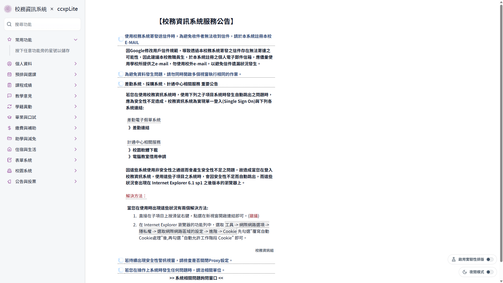
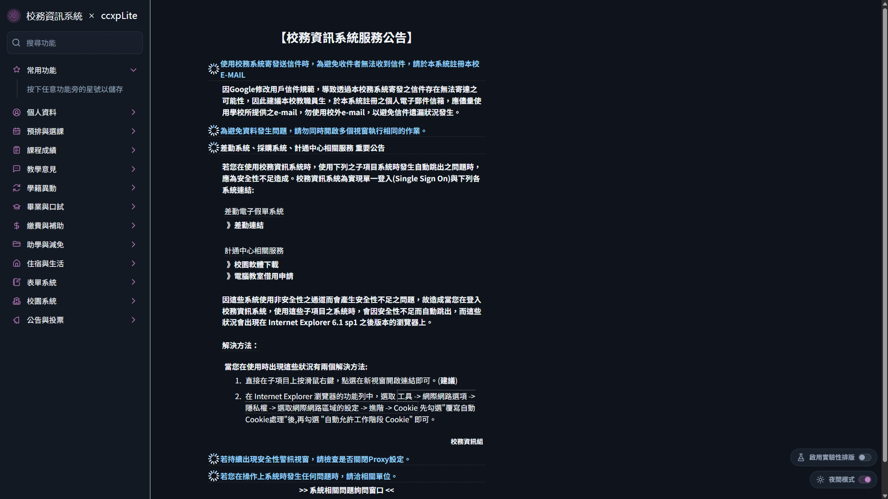
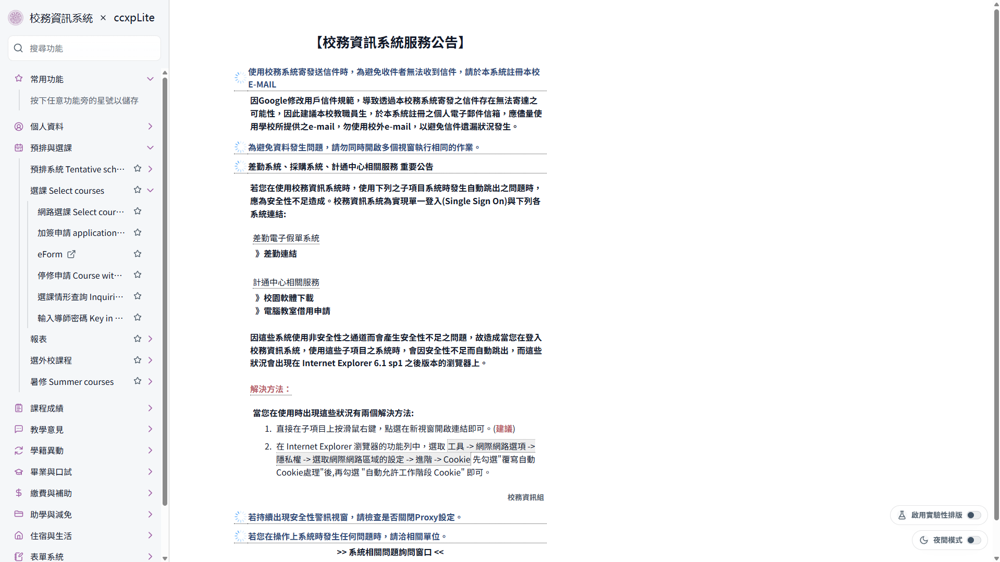
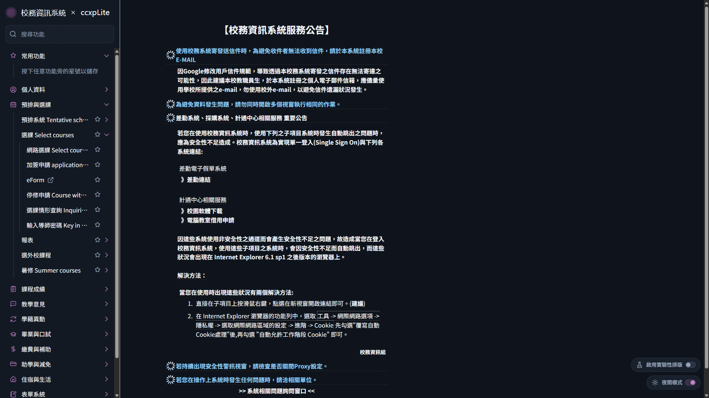
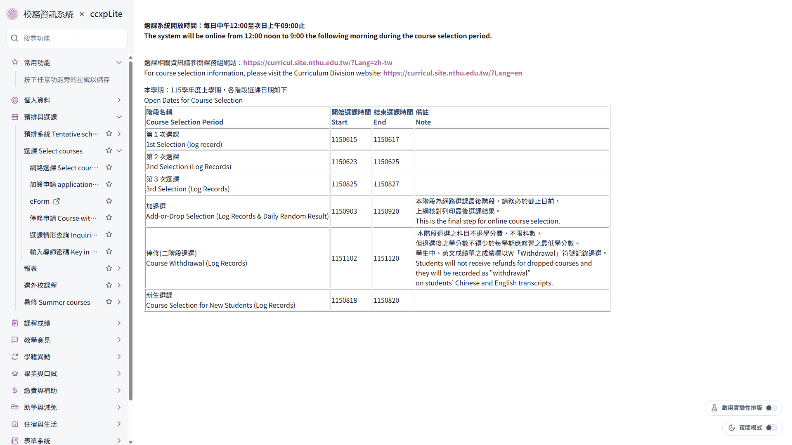
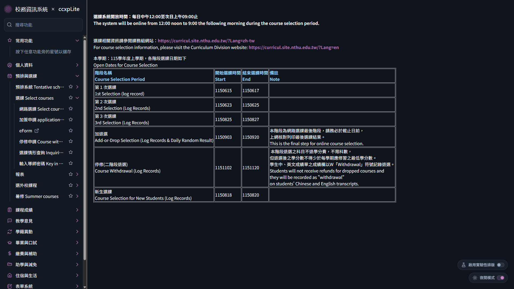

<h1 align="center">ccxpLite</h1>

A lightweight browser extension that improves the usability and navigation experience of the NTHU Academic Information System ([CCXP](https://www.ccxp.nthu.edu.tw/ccxp/INQUIRE/)).

## Features

- Design overhaul for core pages
- Let you pin frequently used functions for quick access
- Login decaptcha with 99.95%+ accuracy (also work for CCXP OAuth, used in [eLearn](https://elearn.nthu.edu.tw/) and [eeclass](https://eeclass.nthu.edu.tw/))
- Automatic multi-day work-hour registration
- Dark mode for improved visual comfort in low-light conditions

## Installation

- [Google Web Store](https://chromewebstore.google.com/detail/glcnfmnbmknbphfgjgbokbbchahmiakk?utm_source=item-share-cb) (dark mode not available)
- [Firebox Add-ons](https://addons.mozilla.org/zh-TW/firefox/addon/ccxplite/) (dark mode not available)

## Demo

| Screen            | Sidebar Mode (Dark Mode Disabled)                                                                             | Sidebar Mode (Dark Mode Enabled)                                                                                        |
| ----------------- | ------------------------------------------------------------------------------------------------------------- | ----------------------------------------------------------------------------------------------------------------------- |
| Login             |                                |                                |
| Main              |                                  |                                  |
| Category Expanded |                |                |
| Funtion Selected  |  |  |

## Decaptcha

The extension bundles decaptcha models from [ccxpDecaptcha](https://github.com/sago-cream/ccxp-decaptcha) and runs inference locally in the content script.

## Design system

Browse the [Storybook component catalog](https://ccxplite.hsichen.dev/storybook/).

## Contributing

Contributions are welcome. Please read the [contribution guide](CONTRIBUTING.md) before opening a pull request. Report security and privacy issues according to our [security policy](.github/SECURITY.md).
